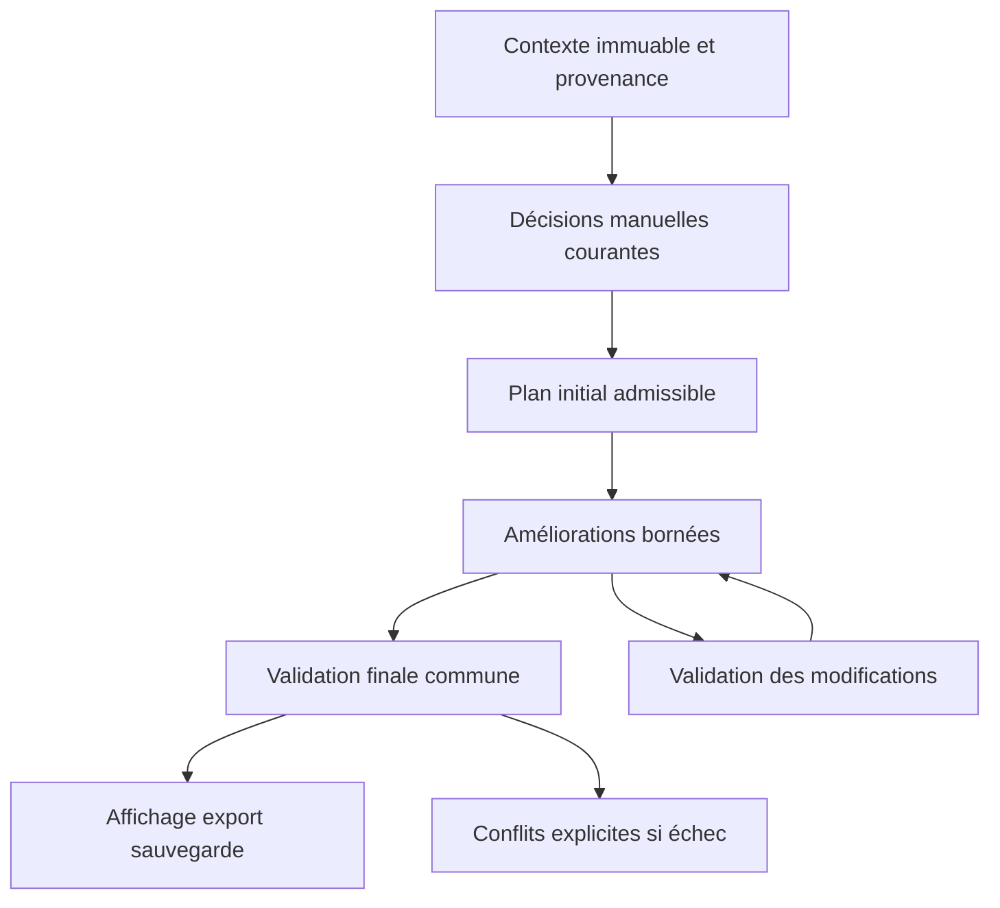

# CAST Retail 9.3.3 — audit approfondi et architecture proposée

16 octobre 2026 · Astra · Pour Roman et Claude

## Verdict : 58/100 — ne pas valider cette version comme conforme au nouveau contrat

La ventilation horaire progresse sur les scénarios nominaux, mais les priorités ne sont pas garanties de bout en bout. Une préférence souple peut supprimer l'ouverture ; une action manuelle peut contourner les contrôles Monthly ; un échec de lecture peut masquer une pause manuelle. Le problème principal n'est pas le nombre de shifts : c'est la coexistence de plusieurs chemins de décision et de réparation, avec des contrôles différents.

La note précédente de 64/100 est abaissée pour les contre-exemples supplémentaires reproduits, pas pour un changement de modèle d'audit. Barème éditorial de risque, et non taux d'adhérence : contraintes et manuel 13/30 ; ventilation et apprentissage 16/25 ; UX/UI 20/25 ; simplicité et robustesse 9/20.

## Périmètre et preuves

- Fichier : `tests/builds/CAST_v9_3_3_RETAIL.html`, blob `18ab0e04563eb80dc3c453476fd3452b857c4aac`.
- SHA-256 : `2471359ad1d637b4472e57ba2e95454d91a605b38d8aa1150b1fab68a940dfb3`.
- Les numéros de lignes ci-dessous se rapportent à ce fichier exact, pas à une version ultérieure.
- Tests locaux isolés, Supabase simulé : aucun changement en production, aucune modification de données réelles. CSC non réaudité.
- Rejeu de 16 combinaisons scénario/version, sondes apprentissage/validation, nouveaux contre-exemples publics synthétiques.
- Revue Firefox précédente dans cette même passe : 54 configurations, 9 vues × clair/sombre × 1440/390/320 px ; zéro erreur JS ni débordement global mesuré. Pages : Dashboard, Monthly, Intraday, Agents, Calendar et quatre sections Settings.
- Traffic n'est pas inclus dans ces 54 vues. La tentative finale d'étendre la matrice a été bloquée par la disparition du binaire Firefox dans l'environnement ; elle n'est pas comptée comme un test réussi.
- Mobile = largeur de viewport Firefox, pas certification sur un vrai iPhone/Android. Firefox d'entreprise et ses politiques ne sont pas reproduits. Les assets externes sont neutralisés : le logo bitmap réel n'est pas certifié.
- Exports Excel/PDF et partage : résultats de la première passe conservés pour ce même blob, pas nouvelle certification exhaustive dans cette passe. Le rendu d'impression clair a été revérifié avant l'indisponibilité du navigateur.

## 1. Incidents de code confirmés

### P0 — une préférence de shift supprime l'ouverture

**Preuve nouvelle :** deux managers présents, catalogue O/M/C, chacun avec préférence C ; résultat : deux C, zéro ouverture, deux fermetures. La préférence est souple ; le minimum d'ouverture existe déjà.

**Code :** affectation anticipée des préférences vers 6150–6165, puis `if (!list.length) return`; `repairDisplayedCoverage`, vers 6666, ne rend mutables que les SA et ne répare donc pas ces managers.

**Correction :** réserver les décisions manuelles explicites, mais pas les préférences souples. Tout placement préféré doit passer par le même test de faisabilité que les autres. Les réparations doivent pouvoir considérer les rôles autorisés à couvrir le magasin, pas seulement SA. Régression minimale : deux managers préférant C doivent conserver une ouverture si une solution admissible existe.

### P0 — le Monthly manuel contourne le contrat de validation

**Preuves conservées :** passer les personnes de fermeture en O laisse une fermeture vide ; cinq C de huit heures payées peuvent donner 40 h pour une limite de 37,5 h. L'écriture manuelle peut être faite avant vérification.

**Code :** `applyCellOverride` 5097–5136 ; `settleWeekHours` 6069–6075 ignore le manuel ; `shiftFor` 6786–6805 retourne l'override ; exclusion des overrides dans la réparation 6666. `brokenRules` 6869–6948 compare deux variantes d'apprentissage, sans constituer un verrou final commun.

**Correction :** préparer le changement, vérifier les jours/semaines/corners affectés, proposer un échange admissible, puis seulement enregistrer. Ne pas effacer silencieusement le choix du manager. Si impossible à appliquer sous les contraintes strictes, expliquer le conflit. Cela concerne Monthly ; l'exception de liberté Intraday doit rester distincte.

### P1 — mauvaise définition de late, et quota manuel non intégré

**Code :** 6234–6241 et 6635–6644, `halfAt = Math.floor(byStart.length / 2)` : dernière moitié au lieu du dernier quart arrondi au supérieur demandé par Roman.

**Preuve conservée :** sur la matrice de catalogues, la cible de 50 % est respectée selon l'ancien classement mais beaucoup moins selon le classement demandé. Les deux notions ne doivent pas être confondues.

**Preuve nouvelle indépendante du classement :** 14 présents, 7 late ; override d'un O en C ; résultat 8 late, sans compensation d'une affectation automatique. Le choix manuel doit être conservé et compté, non ajouté après le calcul du quota.

**Correction :** un seul `classifyLateShifts`, catalogue trié par début puis fin, `k = Math.ceil(N / 4)`, derniers k codes. Exemples : 3→1, 5→2, 17→5, 30→8. Déduire de la cible les late déjà imposés par des choix courants. Dénominateur et arrondi du quota de personnes restent à confirmer, voir arbitrages.

### P1 — une amélioration de trafic peut dégrader la viabilité

**Code :** `best` 6291–6370 filtre le repos mais pas toute la faisabilité hebdomadaire du candidat ; `settleWeekHours` corrige ensuite. Les corrections successives peuvent modifier la couverture et la répartition des jours.

**Résultats :** nominal Japon A, adhérence horaire 90,4→95,0 ; Japon B avec minima, 89,3→90,1. Mais le stress fermeture longue se dégrade sur des indicateurs de corner. Dans le contre-test antérieur à horloge plaçant tout le mois dans le futur, aucun dépassement horaire dans les deux versions, mais corners sans fermeture 16→22 et quarts d'heure vides 170→200.

Les dépassements du scénario exécuté fin octobre concernent des jours passés d'octobre ; ne pas les présenter comme des dépassements futurs de novembre.

**Correction :** tester les contraintes avant d'accepter une modification. Conserver le meilleur plan admissible trouvé. Le garde-fou avec/sans habitudes de la 9.3.3 ne remplace pas une comparaison de non-régression avec la référence. Un échec heuristique doit être nommé « aucune solution trouvée », pas « mathématiquement impossible ».

### P1 — minutes hors grille mal évaluées

**Code :** `floorOf`, 6252–6270, couverture entière d'un slot seulement si `sl.t >= st && sl.t + 15 <= en`.

**Preuves :** 11:50–20:20, durée réelle 510 minutes sans pause, profil crédité de 495 minutes ; shift aligné de même durée crédité de 510. Pause de 20 minutes sur 9h–20h : 640 minutes nettes attendues, 645 évaluées. Les durées non multiples de 15 sont permises par le formulaire.

**Correction exacte pour un intervalle :**

`overlap(s,e,t,Δ) = max(0, min(e,t+Δ) - max(s,t)) / Δ`

Utiliser cette fraction pour la présence et la soustraction des pauses. Pour une pause attendue sur plusieurs débuts admissibles, moyenner ses fractions de recouvrement. Pour le profil réellement placé, soustraire l'union des pauses qui se chevauchent, pas deux fois les mêmes minutes. Distinguer minutes payées et minutes disponibles sur le floor.

Le calcul du banc doit également gérer les fractions ; ajouter une assertion analytique indépendante de conservation des minutes pour ne pas reproduire le même bug dans l'oracle.

### P1 — manuel Intraday : restrictions et réapplication incohérentes

**Code :** `initIntradayDrag` 4676–4738 limite au shift et refuse les chevauchements ; ajout 4785–4803 ; `edgeOverride` 4359–4364 et `withOverride` 4571–4578 filtrent certains overrides. Vers 4212, absence de début automatique admissible : `return` avant lecture du manuel vers 4222.

**Preuve conservée :** une pause manuelle de 13:15 sur un shift 12:00–20:30 peut disparaître si la fenêtre automatique est 10:00–11:00. À l'inverse, déplacer une pause à 15:15 fonctionne dans un chemin ordinaire : ce n'est donc pas un blocage universel hors fenêtre.

**Autre sens du défaut :** réparation automatique 4415–4434 peut sortir de la fenêtre autorisée. Deux agents 08:00–18:00, déjeuner 10:00–11:00 : une pause automatique apparaît à 09:00–10:00.

**Correction :** charger et conserver le manuel avant de chercher un placement automatique. Le moteur respecte les fenêtres ; le manager bénéficie de l'exception demandée. Étendre l'axe et les exports aux intervalles manuels, sinon « autorisé » devient « invisible ». Seules les validations techniques restent bloquantes : durée positive, valeurs finies, identifiants valides. Signaler les conflits sans déplacer le manuel.

### P1 — erreur de lecture traitée comme absence de manuel

**Preuve nouvelle :** pause manuelle à 15:15 ; simulation d'échec de lecture Supabase ; la map d'overrides passe de 1 entrée à 0 et le déjeuner revient automatiquement à 13:00 dans la sonde publique. Aucune suppression en base n'a été testée : c'est une perte de l'état affiché.

**Code :** `loadAndRenderIntraday`, 3977–4004 : les erreurs ne sont pas traitées avant remplacement des structures par les données ou une collection vide.

**Correction :** ne remplacer l'état que lorsque toutes les lectures nécessaires réussissent. Garder le dernier état du même contexte boutique/date, afficher l'erreur et une action Réessayer. Si le contexte change, afficher une indisponibilité plutôt que les anciennes données d'une autre boutique. Garder les protections existantes contre les réponses asynchrones périmées ; empêcher les sauvegardes automatiques depuis un état incomplet.

### P2 — contrastes du thème sombre

Mesures sur couleurs stabilisées, hors transition :

| Élément | Contraste | Diagnostic |
|---|---:|---|
| Initiales d'avatar | 1,32:1 | Très peu lisibles |
| Onglet corner actif / lien de compteur | 3,72:1 | Insuffisant pour petit texte |
| Texte de bouton primaire | 4,46:1 | Légèrement sous 4,5:1 |
| Onglet Settings actif | 4,09:1 | Insuffisant pour petit texte |

**Cause concrète :** `retailAvatarColor` vers 7215 retourne toujours `#EAF0F8`; `renderAgents` 7229–7230 l'injecte en style inline, empêchant le fond sombre prévu par le CSS. Supprimer ce helper constant et l'inline ; utiliser `--avatar-bg`.

Le même `--brand` sert au fond de bouton et au texte des liens. Séparer ces usages : texte accent `#8DB0E3`, fond action `#416BAA`, hover `#4774B4`. Blanc sur ces deux fonds : 5,37 et 4,75 ; accent sur fond actif `#1F2F52` : 5,96. Pour les toasts blancs, conserver des fonds assez sombres, par exemple succès `#215C4B` et erreur `#82334E`. Ne pas éclaircir globalement la couleur de marque : cela dégraderait les boutons blancs.

## 2. Architecture simple pour Claude

Ne pas réécrire toute l'application et ne pas ajouter une nouvelle couche de réparations. Commencer par extraire cinq responsabilités pures dans le fichier existant, puis remplacer les appels progressivement.

### Contrat de données

- `context` : boutique, date, agents, catalogue, horaires, contraintes, absences, données des semaines limitrophes et état de complétude des lectures.
- `manual` : décisions explicites courantes, réservées après traitement de leurs conflits stricts.
- `history` : décisions passées avec provenance ; ce sont des préférences apprises, pas des commandes actuelles.
- `result` : `{ plan, diagnostics, metrics, provenance }` ; un même objet final pour l'écran, l'export et la sauvegarde.
- Le rendu ne doit ni recalculer récursivement les variantes d'apprentissage, ni sauvegarder implicitement des états intermédiaires.

### Fonctions communes

1. `classifyLateShifts(catalogue)` : définition unique du quart supérieur.
2. `coverageOf(plan, context)` et `netFloorProfile(...)` : première/dernière heure complètes, fractions horaires, pauses.
3. `paidMinutes(...)` : calcul distinct du temps disponible au client.
4. `validatePlan(plan, context)` : jours/semaine, séries, repos, heures strictes, couverture magasin/corners selon les règles configurées ; inclure les limites de mois.
5. `tryMove(plan, move, context)` : modification sur copie/delta, validation des zones affectées, acceptation seulement si admissible et meilleure selon les priorités.

Préférer trois mouvements compréhensibles : remplacement d'un shift, échange entre deux personnes, échange de jours admissible. Borner le nombre de passes, retenir le meilleur état, arrêter sans oscillation. Cette recherche est heuristique : ne pas promettre l'optimum global.

### Ordre proposé, à distinguer des arbitrages

1. Contraintes strictes et couverture opérationnelle obligatoire.
2. Décisions manuelles **courantes** compatibles avec ces contraintes.
3. Cible late.
4. Habitudes apprises.
5. Ajustement au trafic.

L'ordre entre 3 et 4 est une proposition, pas une décision déjà obtenue. Les minima d'ouverture/fermeture sont des règles opérationnelles, pas une loi universelle. Les prescriptions légales restent celles du pays et des règles configurées ; cet audit n'est pas une validation juridique mondiale.

Pour late : `L = round(r × P)` seulement si cet arrondi est confirmé ; `L_restant = max(0, L - L_manuel - L_fixe)` sur un périmètre P explicitement défini. Les affectations déjà late doivent être comptées une seule fois. Si le manuel dépasse L, ne pas l'effacer pour atteindre la cible : afficher l'écart et ne pas ajouter d'autres late inutilement.

Pour trafic : avec `ρ_t` la part de trafic du créneau et `B` le budget de présence nette, `T_t = B × ρ_t`, puis minimiser `Σ_t (C_t - T_t)²` parmi les plans admissibles aux niveaux précédents. B et T sont une répartition relative de capacité, pas une preuve de niveau de service commercial. Les pénalités asymétriques éventuelles demandent un arbitrage ; ne pas inventer un coefficient ×2.

Apprentissage : conserver pour cette correction les six mois antérieurs, la décroissance existante et le lissage alpha existant ; ne pas retuner simultanément historique, classification late et faisabilité. La formule actuelle de `best`, `g + habit × abs(g)`, est un compromis numérique, pas une garantie de priorité. Séparer score d'habitude et score trafic dans la comparaison, avec une tolérance explicite si nécessaire. Comparer les variantes avec/sans habitudes sur le même contexte et le même validateur, sans modifier les globals.

## 3. Switch jour/nuit : décision de design proposée

**Bon emplacement actuel :** barre globale, en haut à droite après Help. Il reste accessible sur tous les onglets ; pas besoin de le dupliquer dans chaque panneau Settings.

**Ce qui fonctionne :** soleil/lune, étoiles/nuages, bascule au clavier, mémorisation après rechargement, `prefers-reduced-motion`, retrait du bouton à l'impression. L'icône représente le thème courant. Le thème sombre du système n'est pas automatiquement repris sans préférence sauvegardée ; c'est un choix produit, pas un bug confirmé.

**Proposition testée en isolation et dans l'app locale :**

- Rail visible **52 × 28 px**, contre 66 × 34 actuellement.
- Zone cliquable **52 × 44 px** : compact à l'œil, confortable au doigt.
- Disque 22 px, déplacement 24 px ; transformation 320 ms, apparition 240 ms.
- Soleil doré et nuages en clair ; lune pâle, cratères et étoiles sur rail bleu nuit en sombre.
- Pas d'animation de toute la grille : animer seulement le widget pour éviter des centaines de transitions.
- Libellé accessible stable « Mode sombre », `role="switch"`, `aria-checked`; titre décrit l'action suivante.
- Réduction des mouvements : transitions désactivées. Focus visible conservé.
- Aucun effet sur le planning, aucun appel Supabase, aucun recalcul lors du changement de thème.

Prototype : [HTML autonome](../ui/theme-switch-review-933.html), [CSS de proposition](../ui/theme-switch-compact-933.css). Ce sont des éléments de revue, **pas un remplacement de la version de production**. Le prototype utilise sa propre clé de stockage. Validé à 320 px sans débordement, zéro erreur JS, thème conservé au rechargement. La proposition doit encore passer les tests complets après intégration par Claude.

Références : [inspiration demandée](https://dribbble.com/shots/25761984-Light-Mode-Dark-Mode-Switch), [contraste W3C](https://www.w3.org/WAI/WCAG22/Understanding/contrast-minimum.html), [taille de cible W3C](https://www.w3.org/WAI/WCAG22/Understanding/target-size-minimum.html). Le seuil AA de taille de cible est 24 px sous conditions ; 44 px est ici un choix de confort, pas une obligation AA universelle.

## 4. Arbitrages Roman — pas des bugs

| Question | Proposition simple | Conséquence |
|---|---|---|
| Late ou habitudes apprises en premier ? | Late avant apprentissage, après décisions manuelles actuelles | Protège les missions du soir non représentées dans le trafic |
| Qui entre dans P, dénominateur late ? | Vendeurs séparés de management/stock | Évite que la règle « un manager ferme » déforme la cible vendeurs ; à confirmer |
| Arrondi du nombre de personnes late ? | Garder `round` tant qu'un minimum strict n'est pas demandé | Ne pas confondre avec `ceil(N/4)` qui classe le catalogue |

Les autres décisions sont déjà acquises : pas de dépassement automatique d'heures strictes ; chercher d'abord un échange de jours ; le manuel Intraday n'est pas soumis aux fenêtres automatiques. Ne pas redemander ces arbitrages.

## 5. Simplification / code à retirer ou consolider

- Supprimer `retailAvatarColor` constant et les fonds inline : moins de code, contraste réparé.
- Fusionner les deux définitions de late : un helper testé.
- Centraliser minutes payées, présence nette, couverture et validation ; éviter une formule différente dans chaque réparation/export/banc.
- Remplacer le rendu récursif à globals pour tester les habitudes par deux calculs purs et une comparaison.
- Les contrôles d'overrides Intraday dispersés doivent devenir deux chemins explicites, automatique et manuel, avec une seule réapplication du manuel.
- Ne pas déclarer du CSS « mort » sur une seule capture : exports, mobile, menus et erreurs utilisent des états conditionnels. Aucun lot de suppression aveugle recommandé.
- Aucun lien mort certifié par cette passe ; les routes externes étaient neutralisées. Un contrôle réseau séparé est nécessaire avant suppression d'un lien ou asset.
- Commentaires à conserver : pourquoi une exception métier existe. Remplacer les promesses « jamais », « optimal », « identique » par le contrat réellement testé.

## 6. Ordre de correction et critères de sortie

1. Corriger les deux P0 et la lecture Intraday en erreur. Ne pas mélanger cette étape à un réglage des poids d'apprentissage.
2. Définition late unique, manuel inclus dans le quota, tests 3/5/17/30 shifts.
3. Profils fractionnaires et validation avant mouvement ; rejouer le nominal et tous les stress.
4. Séparer manuel/automatique Intraday ; tester déplacement, ajout, chevauchement, fenêtre impossible, reload et export.
5. Tokens contrastes puis switch compact ; captures clair/sombre/mobile et Traffic à reprendre.

Critères : aucune violation supplémentaire par rapport au plan admissible de référence ; pas de perte de décision manuelle sur erreur de lecture ; absence de plan conforme clairement signalée ; invariants identiques pour affichage et export. Le maintien de la viabilité prime sur le gain d'adhérence.

Sonde publique : `tests/retail/bm/probe_deep_priorities_933.js`, à exécuter uniquement sur le banc synthétique, avec `setup.js`, horloge figée au 31 octobre 2026 et snapshots désactivés. Attendre sa Promise. Elle restaure les globals modifiés ; aucun vrai accès Supabase n'est nécessaire. Résultats associés dans `2026-10-16_astra_audit-933-approfondi-results.json`.

**Aucune version Retail/CSC n'a été poussée. Aucun SQL ni changement Supabase.**
